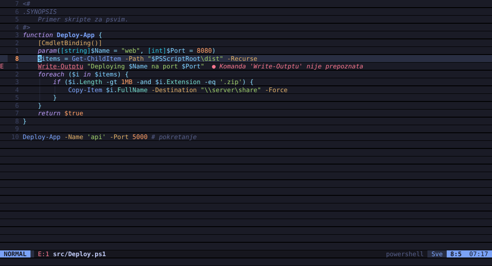
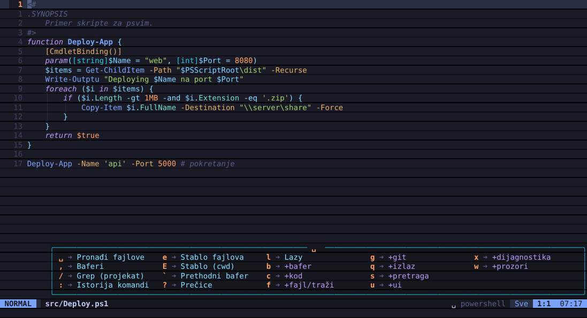
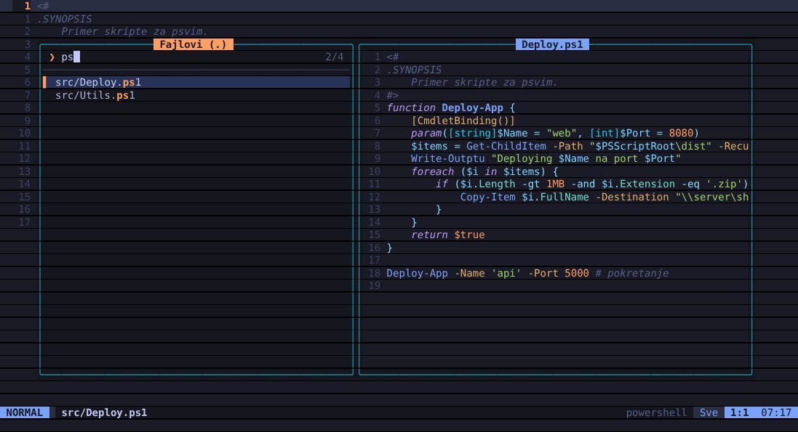
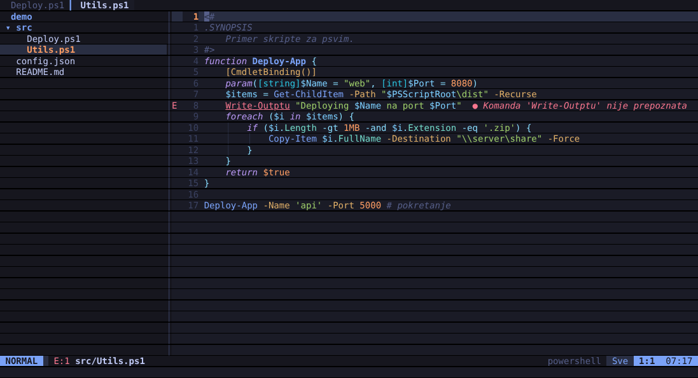

# psvim — vim i LazyVim za PowerShell

Modalni editor koji se pokreće direktno iz PowerShell-a (`psvim fajl.ps1`) i vim mod u samom promptu, sa onim što LazyVim čini prijatnim: leader meni sa which-key popup-om, fuzzy pretraga fajlova i teksta sa pregledom, stablo fajlova, flash skokovi, statusna linija, lista bafera, dijagnostika i dopuna koda.



## Šta radi

**Editor (`psvim`)**
- Modovi: Normal, Insert, Visual, V-Line, Replace, komandna linija
- Kretanja: `h j k l w b e ge W B E 0 ^ $ g_ gg G f F t T ; , % { } M`, brojevi (`3w`, `5j`), `/ ? n N * #`, oznake `m` `'` `` ` ``, skokovi `<C-o> <C-i>`
- Operatori: `d c y > < = gu gU g~ gc` uz bilo koje kretanje ili tekst objekat
- Tekst objekti: `iw aw iW aW i" a" i' a' i( a( i{ a{ i[ a[ i< ip ap` plus `if af` (funkcija) i `ig` (ceo fajl)
- `.` ponavljanje, makroi (`qa … q`, `@a`, `@@`), registri (`"a`, `"A`, `"_`, `"0`, `"+`), `u` / `<C-r>`, `<C-a>` / `<C-x>`
- Ex komande: `:w :q :wq :x :e :bn :bd :ls :%s/a/b/g :g/x/d :v/x/d :sort :norm :m :t :retab :!cmd :r !cmd :'<,'>!Sort-Object`
- Sistemski clipboard je podrazumevan (kao `clipboard=unnamedplus` u LazyVim-u)

**LazyVim sloj**
- Leader je razmak; posle kratke pauze iskače which-key meni sa grupama
- Fuzzy picker (Telescope / snacks): fajlovi, live grep, baferi, nedavni fajlovi, simboli, linije bafera, prečice, istorija komandi, dijagnostika, git status, teme
- Stablo fajlova (neo-tree): dodaj, obriši, preimenuj, kopiraj, skriveni fajlovi
- Flash (`s`): otkucaj 1–2 slova pa oznaku za skok; radi i uz operatore (`ds…`)
- Statusna linija (lualine), linija bafera (bufferline), plutajuća komandna linija (noice), obaveštenja
- Auto zagrade (mini.pairs), komentarisanje `gcc` / `gc` (mini.comment), vodiči uvlačenja, `<Esc>` gasi isticanje pretrage
- Teme: tokyonight (podrazumevana), catppuccin, gruvbox, kanagawa
- Dashboard pri pokretanju bez fajla

**PowerShell integracija**
- Bojenje sintakse za PowerShell (here-string, `$promenljive` u stringovima, tipovi, parametri, operatori); osnovno bojenje i za C#, JSON, Markdown, XML, YAML, Python, JS/TS, Go, Rust, SQL, Lua, shell
- Dijagnostika uživo preko PowerShell parsera: greške i nepoznate komande u margini i kao virtuelni tekst (`]d` `[d`, `␣xx`)
- PSScriptAnalyzer (ako je instaliran): upozorenja pri snimanju i formatiranje (`␣cf`)
- `K` prikazuje `Get-Help` za komandu pod kursorom
- Dopuna u insert modu (`<C-Space>` / `<C-n>`) preko `TabExpansion2`: komande, parametri, promenljive, putanje, članovi
- `gd` nalazi definiciju funkcije (u fajlu ili projektu), `gr` reference, `gf` otvara putanju pod kursorom (razume `$PSScriptRoot`)
- `␣cx` pokreće trenutni fajl i prikazuje izlaz, `<C-/>` otvara ugnežđeni terminal, `␣gg` lazygit
- `Get-Process | psvim` otvara izlaz komande u baferu

**Prompt (PSReadLine)**
- Vi mod sa oblikom kursora (blok / crta), tokyonight boje
- U normal modu razmak otvara leader meni: `␣␣` otvori fajl, `␣fi` ubaci putanju, `␣/` grep, `␣:` istorija, `␣fd` promeni folder, `␣v` ili `v` uredi komandu u psvim-u, `K` Get-Help
- U insert modu: `Ctrl+t` ubaci putanju, `Ctrl+r` istorija (fzf stil), `Tab` meni dopune, `Ctrl+y` prihvati predlog





Kratko uputstvo za početak: [UPUTSTVO.md](UPUTSTVO.md)

## Instalacija

Radi u **Windows PowerShell 5.1** (ugrađen u Windows 10/11, treba .NET Framework 4.7.2+) i u **PowerShell 7.4+** (Windows, Linux, macOS). PowerShell 7 je brži i ima bolje predloge u promptu, ali sve funkcije editora rade u obe verzije.

Jedna komanda — preuzima psvim, instalira modul, podešava `$PROFILE` i konfiguraciju:

```powershell
irm https://raw.githubusercontent.com/vladimir-stojadinov/psvim/main/setup.ps1 | iex
```

Ili iz kloniranog repozitorijuma:

```powershell
git clone https://github.com/vladimir-stojadinov/psvim
cd psvim
./setup.ps1
```

Setup postavlja nekoliko pitanja (vim mod u promptu, tema, relativni brojevi, Nerd Font, uvlačenje, PSScriptAnalyzer, lazygit), a zatim:

1. instalira za PowerShell iz kog je pokrenut — **Windows PowerShell 5.1** ili **PowerShell 7.4+** — a ako na računaru postoji i drugi, nudi da instalira i za njega
2. instalira modul u korisnički folder za module
3. dodaje blok `# >>> psvim >>>` u `$PROFILE` (pravi rezervnu kopiju `.psvim-bak`; ostatak profila ne dira)
4. pravi `~/.config/psvim/config.json`
5. proverava da se modul učitava

| Opcija | Šta radi |
|---|---|
| `-Yes` | bez pitanja, sve podrazumevano |
| `-Theme catppuccin` | tema (`tokyonight`, `catppuccin`, `gruvbox`, `kanagawa`) |
| `-NoPrompt` | bez vim moda u promptu (samo `psvim` editor) |
| `-NoAnalyzer` / `-NoLazygit` | preskoči dodatke |
| `-ResetConfig` | prepiši postojeću konfiguraciju |
| `-Build` | izgradi DLL-ove iz koda (treba .NET 8 SDK); inače se koriste gotovi |
| `-Uninstall` | ukloni modul i blok iz `$PROFILE` (konfiguracija ostaje) |

Za ažuriranje samo ponovo pokreni setup. Ako javi da ne može da obriše modul, zatvori PowerShell prozore u kojima je psvim učitan.

Za razvoj: `./build.ps1 -Test` (build + testovi), `./build.ps1 -Install`.

Preporuka: Nerd Font (npr. `JetBrainsMono Nerd Font`) u terminalu za ikonice.

## Korišćenje

```powershell
psvim skripta.ps1          # otvori fajl
psvim +42 skripta.ps1      # otvori na liniji 42
psvim .                    # stablo fajlova
psvim                      # dashboard
Get-ChildItem | psvim      # izlaz komande u baferu
Edit-PsVimConfig           # konfiguracija
```

Alias `vim` / `vi` postoji samo ako pravi vim nije instaliran. `v` je uvek alias za `psvim`.

U editoru: `:help` (ili `F1`) otvara pregled svih prečica, `␣sk` ih pretražuje, a `:checkhealth` pokazuje šta je dostupno.

### Najvažnije leader prečice

| Prečica | Radnja | Prečica | Radnja |
|---|---|---|---|
| `␣␣` `␣ff` | pronađi fajl | `␣/` `␣sg` | grep |
| `␣,` `␣fb` | baferi | `␣fr` | nedavni fajlovi |
| `␣e` | stablo fajlova | `␣fn` | novi fajl |
| `␣sw` | traži reč pod kursorom | `␣ss` | simboli (funkcije) |
| `␣sb` | linije bafera | `␣sk` | sve prečice |
| `␣bd` | zatvori bafer | `␣bo` | zatvori ostale |
| `␣cf` | formatiraj | `␣cx` | pokreni fajl |
| `␣cd` | dijagnostika linije | `␣xx` | lista dijagnostike |
| `␣cR` | preimenuj fajl | `␣sr` | traži i zameni reč |
| `␣gg` | lazygit | `␣gs` `␣gl` `␣gd` `␣gb` | git status / log / diff / blame |
| `␣uC` | tema | `␣ul` `␣uL` `␣ud` `␣up` | brojevi / relativni / dijagnostika / auto zagrade |
| `␣fc` | konfiguracija | `␣qq` | izlaz |

Ostalo: `H` / `L` prethodni/sledeći bafer, `<C-h>` / `<C-l>` fokus stablo/editor, `<C-s>` sačuvaj, `s` flash, `gcc` komentar.

## Konfiguracija

`~/.config/psvim/config.json` (ili `$env:PSVIM_CONFIG`). Snimanje ovog fajla u psvim-u odmah ga ponovo učitava.

```jsonc
{
  "theme": "tokyonight",        // catppuccin, gruvbox, kanagawa
  "relativeNumber": true,
  "tabStop": 4,
  "shiftWidth": 4,
  "expandTab": true,
  "nerdFont": false,
  "autoPairs": true,
  "clipboard": "unnamedplus",   // "" = samo interni registri
  "autoFormatOnSave": false,
  "whichKeyDelay": 300,
  "ignore": [".git", "node_modules", "bin", "obj"],
  "keymaps": [
    { "mode": "n", "lhs": "<leader>td", "rhs": ":!Get-Date<CR>", "desc": "Datum" },
    { "mode": "n", "lhs": "<C-t>", "rhs": ":Explore<CR>" }
  ]
}
```

Opcije se menjaju i u letu: `:set rnu! ts=2 sw=2`, `:colorscheme catppuccin`.

`$PsVimOptions.CheckCommands = $false` isključuje upozorenja za nepoznate komande.

## Arhitektura

```
src/PsVim.Core/        C#, bez spoljnih zavisnosti; builduje se za net8.0 (PowerShell 7)
                       i net472 (Windows PowerShell 5.1) iz istog koda (Compat.cs, MiniJson.cs)
  Editor*.cs           modovi, kretanja, operatori, ex komande, LazyVim sloj
  Buffer.cs            tekst, undo/redo, učitavanje/snimanje (čuva BOM i CRLF)
  Screen.cs            dvostruki bafer, šalje terminalu samo razlike (truecolor ANSI)
  Syntax.cs            lekseri (PowerShell + opšti)
  Ui.cs                picker, fuzzy algoritam, which-key
  Files.cs             nabrajanje fajlova, grep, nedavni fajlovi, stablo
  PromptUi.cs          picker-i i which-key za PSReadLine
module/PsVim/          PowerShell modul (bin/ za PS 7, bin/net472/ za PS 5.1): kuke (clipboard, Get-Help, parser,
                       PSScriptAnalyzer, TabExpansion2) i PSReadLine prečice
tests/PsVim.Tests/     238 testova koji "kucaju" tastere i proveravaju rezultat
```

Editor ne zavisi od PowerShell SDK-a; sve što traži PowerShell ide kroz `PsVim.Hooks` delegate koje modul popunjava skriptblokovima. Zato se jezgro testira bez PowerShell-a, a modul radi na Windows-u, Linux-u i macOS-u.

## Ograničenja (za sada)

- U Windows PowerShell 5.1 inline predlozi u promptu traže PSReadLine 2.1+ (`Install-Module PSReadLine -Scope CurrentUser -Force`); uz ugrađeni PSReadLine 2.0 sve ostalo radi
- Nema podele prozora (split) ni prelamanja dugih linija (koristi se horizontalno skrolovanje)
- Široki znakovi (emoji, CJK) prikazuju se kao `□`, a nevidljivi i kontrolni kao `?` (da se ekran ne bi raspao)
- Binarni fajlovi (exe, dll, zip) otvaraju se samo za čitanje
- Dijagnostika i dopuna su PowerShell-specifične; drugi jezici imaju bojenje i dopunu rečima iz bafera
- Undo istorija se ne čuva između sesija

Ideje za sledeće verzije: git znakovi u margini (gitsigns), split prozori, `:terminal` u prozoru, surround (`ys`, `cs`, `ds`), višestruki kursori.
